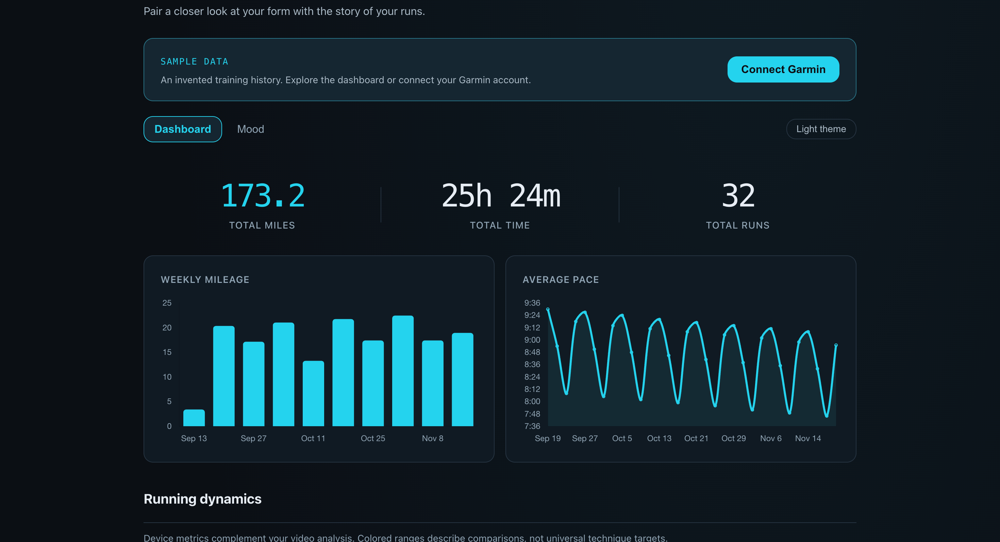

# Runform

**Find your stride. Understand your form.**

Runform combines **video form analysis** and **Garmin training analytics** in one local running app. Its main workspace turns a side-view running video into an interactive breakdown of how you move, using MediaPipe to track 33 body landmarks, detect foot strikes, and estimate running metrics. The Garmin Analytics tab adds the longer-term view: activity history, trends, route maps, and optional coaching.


### Pose tracking in action


An uploaded side-view running clip with the app's pose overlay. The connected landmarks follow the runner's joints during playback and support the stride measurements shown in the guided tour.

## Features

- **Two connected workspaces:** Form analysis stays the home screen; Garmin Analytics opens a training dashboard in the same app.
- **Garmin history and trends:** weekly mileage, pace, heart rate, cadence, vertical ratio, and ground contact time. Open any run for its route map, full metric breakdown, and eight time-series charts.
- **Explore immediately:** a clearly labeled synthetic training history, sample coaching, and a mood avatar work without a Garmin account or API key. Connect Garmin when you want to view your own runs.
- **Five running metrics:** cadence, trunk lean, knee angle at landing, vertical oscillation, and overstride.
- **Interactive playback:** pose overlay, measurement scenes, slow motion, fullscreen, and a detailed results breakdown.
- **Foot-path comparison:** your ankle's average path alongside a target adjusted near landing to bring the foot closer under the hips.
- **Optional demo:** a four-step tutorial and guided tour using a local sample clip.
- **Browser or CLI:** upload a video through the local web interface, or export a JSON report from the terminal.
- **Local video processing:** video analysis stays on your machine. The pose model downloads on first use. Garmin data loads from Garmin Connect only after you connect; optional AI coaching sends selected metrics to Google only when requested.

## Getting started

Video analysis and the Garmin demo require **Python 3.11 or newer** and a video format supported by your OpenCV installation, such as MP4. Live Garmin connection uses the optional extra described below and currently requires **Python 3.12 or newer**.

```bash
git clone https://github.com/avyaynamburi/runform.git
cd runform
python3 -m venv .venv
source .venv/bin/activate
python -m pip install -e ".[dev]"
runform serve
```

On Windows, activate the environment with `.venv\Scripts\Activate.ps1` in PowerShell instead.

Open **http://127.0.0.1:8000**, choose a side-view running video, and wait for analysis. The guided tour highlights each measurement; close it or choose **Full breakdown** to see the metric cards. Browser uploads are limited to **300 MB**.

The first analysis downloads the MediaPipe Pose Landmarker model to `~/.cache/runform/pose_landmarker_full.task`. Later analyses reuse the cached model. To use a model you already downloaded:

```bash
runform serve --model /path/to/pose_landmarker_full.task
```

### Try the demo

Provide your own sample clip to enable the tutorial's demo tour:

```bash
runform serve --demo /path/to/running-video.mp4
```

Then select **How it works** in the browser. If `samples/demo_run.mp4` exists, `runform serve` uses it automatically. Sample videos and model files are excluded from Git and are not included in a fresh clone.

### Garmin Analytics

Select **Garmin Analytics** in the top navigation, or open **http://127.0.0.1:8000/garmin**. It starts on 32 invented runs across multiple weeks, labeled **SAMPLE DATA**. No personal workout data or credentials are bundled.

- Explore weekly mileage, pace, cadence, and vertical-ratio charts.
- Select a run to see its full metrics, example route, and pace, heart-rate, cadence, ground-contact, vertical-oscillation, vertical-ratio, stride-length, and elevation traces.
- Switch to **Mood** for the activity-aware avatar.
- Select **Show sample coaching** for prewritten examples. These do not call an AI provider.
- Select **Connect Garmin** to sign in, complete MFA if required, and load your real running activities. **Disconnect** returns to the demo.

The tab adapts the existing RunStats / Garmin Analytics code into Runform's Flask application; the original standalone project remains separate. Both workspaces share Runform navigation, typography, and the dark/cyan visual theme. Analytics also offers a light theme.



#### Connect a real Garmin account

Use a Python 3.12+ environment, then install the optional integration dependencies:

```bash
python -m pip install -e ".[dev,garmin]"
runform serve
```

Garmin login and pending MFA are isolated per browser session. Credentials and tokens remain in memory and are cleared on disconnect or server restart; idle sessions expire after one hour. Runform refuses `GARMINTOKENS` disk-token configuration, so unset it before connecting. This remains a local application: the default server binds to `127.0.0.1`.

The connector uses the unofficial `garminconnect` library; Garmin service changes can affect live sign-in. Garmin running-dynamics fields depend on the device and accessory used to record each workout. Missing fields display as `—`, and incomplete chart samples remain missing rather than becoming zeros.

#### Optional Gemini coaching

The demo and all charts work without an AI key. To request coaching for connected workouts, create a `.env` file in the Runform checkout using [.env.example](.env.example), or set environment variables:

```text
GEMINI_API_KEY=your-key-here
GEMINI_MODEL=gemini-3.8-flash
```

The model is configurable. Requests are made only when you select a coaching or chart-insight button in connected mode. These send selected scalar run metrics to Google Gemini; GPS routes, Garmin credentials, and activity titles are excluded. Provider usage may incur charges. Keep `.env` and keys out of Git.

Charts load Chart.js, and maps load Leaflet and OpenStreetMap tiles. These frontend libraries/tiles need an internet connection; summaries, activity tables, and mood remain usable if chart libraries cannot load. The route in demo mode is synthetic. Coaching is generated commentary; colored metric ranges are descriptive comparisons, not individual technique prescriptions.

Garmin distances use miles, pace uses minutes per mile, elevation uses feet, stride length uses meters, vertical oscillation uses centimeters, and ground contact uses milliseconds. Video vertical oscillation uses **relative body height**, so its percentage is not interchangeable with the device's centimeter measurement or vertical ratio.

Export the same normalized demo data and aggregate report from the terminal:

```bash
runform garmin --demo --out activities.json
```

### Analyze from the terminal

```bash
runform analyze /path/to/running-video.mp4 --out report.json
```

This prints a summary and writes the full JSON report. Without `--out`, the report is saved as `r.json`. The CLI also accepts `--model /path/to/model.task`.

Example summary from a local sample clip:

```text
FPS: 30; frames total: 847; frames with pose: 847
Cadence: 180.0 spm
Trunk lean: 6.8 deg
Knee at strike: 157.1 +/- 5.8 deg
Vertical oscillation: 0.082 of body height
Overstride: 0.076 of body height ahead of hips
```

## What the metrics mean

| Metric | Measurement |
| --- | --- |
| Cadence | Steps per minute, estimated from intervals between same-foot strikes. |
| Trunk lean | Angle of the hip-to-shoulder line relative to vertical. |
| Knee at strike | Hip–knee–ankle angle at landing, reported as mean and standard deviation; 180° is straight. |
| Vertical oscillation | Hip movement from peak to trough over a stride, relative to estimated body height. |
| Overstride | Forward ankle offset from the hips at landing on the more visible side, relative to estimated body height. |

The report also includes frame rate, total frames, frames with a detected pose, detected strike count, the more visible side, and tracking warnings. Metrics without enough usable data are reported as `null`.

## Recording a useful clip

- Film one runner from the side with a steady camera and the full body visible.
- Aim for 10–20 seconds of steady running at 30 fps or higher.
- Use good lighting and keep the feet visible throughout the stride.

Measurements are estimates from 2D video. Camera angle, occlusion, frame rate, and pose quality affect the results. Distances use relative body height rather than meters. The foot-path target is an adjustment of the runner's own path near landing, rather than a validated ideal gait.

## How it works

```text
Video → Pose landmarks → Gap filling & smoothing → Foot strikes & metrics
                                                        ↓
                                               JSON report / Web tour
```

OpenCV reads the video, MediaPipe estimates body landmarks, and NumPy/SciPy handle smoothing and measurement. Flask serves both the video upload API and namespaced Garmin endpoints. Plain JavaScript and Canvas render the pose overlays; the adapted Garmin workspace uses Chart.js and Leaflet. Garmin activity summaries and descriptor-indexed detail streams pass through a shared normalization pipeline before being returned to the browser.

```text
src/runform/
  cli.py          Terminal commands
  web.py          Flask app and analysis endpoints
  pipeline.py     Shared analysis pipeline
  video.py        Video decoding
  pose.py         MediaPipe pose extraction
  smoothing.py    Gap filling and signal smoothing
  gait.py         Foot-strike detection and cadence
  metrics.py      Joint angles, oscillation, and foot paths
  report.py       Video JSON report construction
  garmin.py       Garmin sessions, normalization, reports, optional coaching API
  garmin_demo.py  Invented activities, detail streams, and sample coaching
  static/         Browser interface, styling, and overlays
tests/            Synthetic fixtures and CLI/API/unit tests
```

## Development

With the development dependencies installed:

```bash
ruff check .
pytest -q
```

Most tests use synthetic landmarks and mocked pose extraction; video decoding is checked with a generated blank clip. Garmin tests use fake clients and synthetic data, with no external calls or account credentials. The real pose-extraction test runs only when the model is already cached and skips otherwise. Tests do not download the model. For an additional check with your own clip:

```bash
runform analyze /path/to/running-video.mp4 --out report.json
```

See [AGENTS.md](AGENTS.md) for repository conventions and [docs/PLAN.md](docs/PLAN.md) for the implementation plan.

## Combined project description

A concise resume description you can adapt:

> Built a Python/Flask running analytics application combining MediaPipe video gait analysis with Garmin Connect activity syncing, interactive training trends, run-detail charts and route maps, and optional Gemini coaching.

Live Garmin/MFA and Gemini paths are covered by offline fake-client tests; connecting a real account and making paid AI calls require your own configuration and are separate from the credential-free demo.
