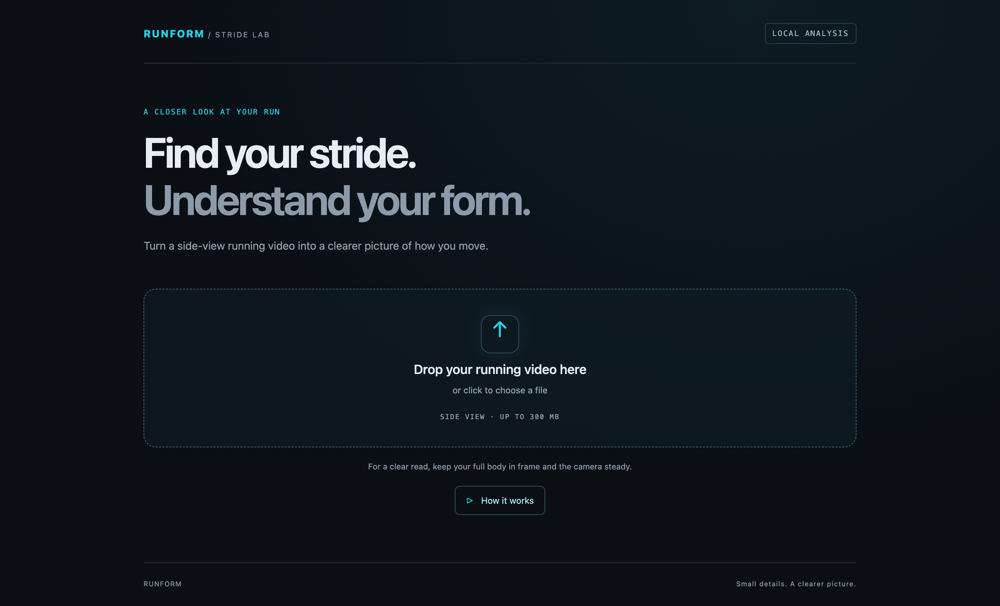
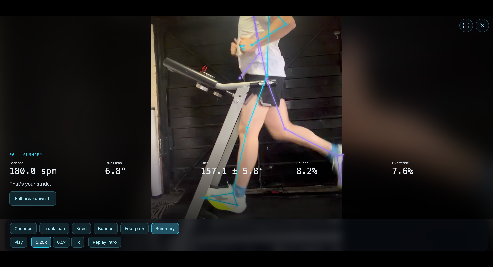

# Runform

**Find your stride. Understand your form.**

Runform turns a side-view running video into an interactive breakdown of how you move. It uses MediaPipe pose tracking to follow 33 body landmarks, detect foot strikes, and estimate running metrics, with a skeleton overlay and a guided visual tour.



### Pose tracking in action



An uploaded side-view running clip with the app's pose overlay. The connected landmarks follow the runner's joints during playback and support the stride measurements shown in the guided tour.

## Features

- **Five running metrics:** cadence, trunk lean, knee angle at landing, vertical oscillation, and overstride.
- **Interactive playback:** pose overlay, measurement scenes, slow motion, fullscreen, and a detailed results breakdown.
- **Foot-path comparison:** your ankle's average path alongside a target adjusted near landing to bring the foot closer under the hips.
- **Optional demo:** a four-step tutorial and guided tour using a local sample clip.
- **Browser or CLI:** upload a video through the local web interface, or export a JSON report from the terminal.
- **Local processing:** when run on your computer, video analysis stays on your machine. The pose model downloads on first use.

## Getting started

Requires **Python 3.11 or newer** and a video format supported by your OpenCV installation, such as MP4.

```bash
git clone https://github.com/avyaynamburi/runform.git
cd runform
python3 -m venv .venv
source .venv/bin/activate
python -m pip install -e ".[dev]"
runform serve
```

On Windows, activate the environment with `.venv\Scripts\Activate.ps1` in PowerShell instead.

Open **http://127.0.0.1:8000**, choose a side-view running video, and wait for analysis. The guided tour highlights each measurement; close it or choose **Full breakdown** to see the metric cards. Browser uploads are limited to **300 MB**.

The first analysis downloads the MediaPipe Pose Landmarker model to `~/.cache/runform/pose_landmarker_full.task`. Later analyses reuse the cached model. To use a model you already downloaded:

```bash
runform serve --model /path/to/pose_landmarker_full.task
```

### Try the demo

Provide your own sample clip to enable the tutorial's demo tour:

```bash
runform serve --demo /path/to/running-video.mp4
```

Then select **How it works** in the browser. If `samples/demo_run.mp4` exists, `runform serve` uses it automatically. Sample videos and model files are excluded from Git and are not included in a fresh clone.

### Analyze from the terminal

```bash
runform analyze /path/to/running-video.mp4 --out report.json
```

This prints a summary and writes the full JSON report. Without `--out`, the report is saved as `r.json`. The CLI also accepts `--model /path/to/model.task`.

Example summary from a local sample clip:

```text
FPS: 30; frames total: 847; frames with pose: 847
Cadence: 180.0 spm
Trunk lean: 6.8 deg
Knee at strike: 157.1 +/- 5.8 deg
Vertical oscillation: 0.082 of body height
Overstride: 0.076 of body height ahead of hips
```

## What the metrics mean

| Metric | Measurement |
| --- | --- |
| Cadence | Steps per minute, estimated from intervals between same-foot strikes. |
| Trunk lean | Angle of the hip-to-shoulder line relative to vertical. |
| Knee at strike | Hip–knee–ankle angle at landing, reported as mean and standard deviation; 180° is straight. |
| Vertical oscillation | Hip movement from peak to trough over a stride, relative to estimated body height. |
| Overstride | Forward ankle offset from the hips at landing on the more visible side, relative to estimated body height. |

The report also includes frame rate, total frames, frames with a detected pose, detected strike count, the more visible side, and tracking warnings. Metrics without enough usable data are reported as `null`.

## Recording a useful clip

- Film one runner from the side with a steady camera and the full body visible.
- Aim for 10–20 seconds of steady running at 30 fps or higher.
- Use good lighting and keep the feet visible throughout the stride.

Measurements are estimates from 2D video. Camera angle, occlusion, frame rate, and pose quality affect the results. Distances use relative body height rather than meters. The foot-path target is an adjustment of the runner's own path near landing, rather than a validated ideal gait.

## How it works

```text
Video → Pose landmarks → Gap filling & smoothing → Foot strikes & metrics
                                                        ↓
                                               JSON report / Web tour
```

OpenCV reads the video, MediaPipe estimates body landmarks, and NumPy/SciPy handle smoothing and measurement. Flask serves the local upload API; plain JavaScript and Canvas render the playback and overlays.

```text
src/runform/
  cli.py          Terminal commands
  web.py          Flask app and analysis endpoints
  pipeline.py     Shared analysis pipeline
  video.py        Video decoding
  pose.py         MediaPipe pose extraction
  smoothing.py    Gap filling and signal smoothing
  gait.py         Foot-strike detection and cadence
  metrics.py      Joint angles, oscillation, and foot paths
  report.py       JSON report construction
  static/         Browser interface, styling, and overlays
tests/            Synthetic fixtures and CLI/API/unit tests
```

## Development

With the development dependencies installed:

```bash
ruff check .
pytest -q
```

Most tests use synthetic landmarks and mocked pose extraction; video decoding is checked with a generated blank clip. The real pose-extraction test runs only when the model is already cached and skips otherwise. Tests do not download the model. For an additional check with your own clip:

```bash
runform analyze /path/to/running-video.mp4 --out report.json
```

See [AGENTS.md](AGENTS.md) for repository conventions and [docs/PLAN.md](docs/PLAN.md) for the implementation plan.
